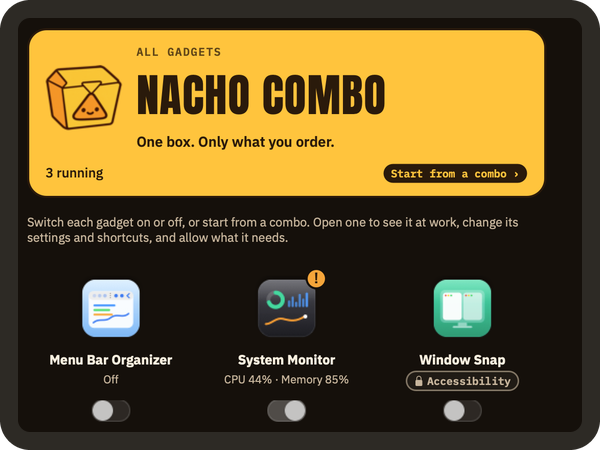
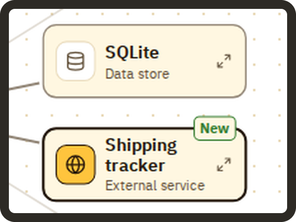

<picture>
  <source media="(prefers-color-scheme: dark)" srcset="https://raw.githubusercontent.com/mafianacho/.github/1d071df2c79a1875cd3e0cad178db86fdc5fafde/profile/assets/logo-horizontal-dark.png">
  
</picture>

**AI 시대에 만드는 사람을 돕는 작은 도구들을 만듭니다.**
 
We make small tools that help people who build in the age of AI.

[mafianacho.com](https://mafianacho.com)

## 만드는 것 · What we make

<table>
<tr>
<td width="33%" valign="middle" align="center"></td>
<td width="33%" valign="middle" align="center"></td>
<td width="33%" valign="middle" align="center"></td>
</tr>
<tr>
<td width="33%" valign="top"><b><a href="https://github.com/mafianacho/nachocombo">Nacho Combo</a></b> Menu bar organizer, system monitor and window snapping for macOS</td>
<td width="33%" valign="top"><b><a href="https://github.com/mafianacho/nacholens">Nacho Lens</a></b> See what an AI changed in a backend, without reading code: one page that animates each use case through your services, with the git diff highlighted.</td>
<td width="33%" valign="top"><b><a href="https://github.com/mafianacho/domain-cheatsheets">Domain Cheatsheets</a></b> 모르는 분야도 AI에게 정확히 시킬 수 있게 — 도메인별 용어 치트시트 + MCP 서버 (UI·모션·3D·법·패션·건설·회계)</td>
</tr>
</table>

## 링크 · Links

- 홈페이지 · Website: [mafianacho.com](https://mafianacho.com)
